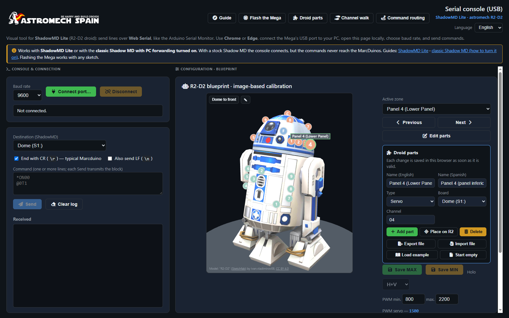

# ShadowMD serial web console — user manual

The serial web console is a page you open in Chrome or Edge on your laptop. You plug the USB cable into your droid's Arduino Mega, and from the page you can open and close every panel, move the holos, find the end points of each servo and save them on the MarcDuinos, all while looking at R2 instead of typing codes from memory. It can also load a new sketch onto the Mega.

Nothing is installed and nothing goes to a server: it is one page that runs in your browser, and it works without internet, so you can use it next to the droid in the garage.

**Interface language:** English or Spanish, from the **Language** selector at the top right. The page remembers your choice.

---

## Contents

1. [What you need](#1-what-you-need)
2. [Opening the console](#2-opening-the-console)
3. [The first-run guide](#3-the-first-run-guide)
4. [The screen at a glance](#4-the-screen-at-a-glance)
5. [Connecting and sending commands](#5-connecting-and-sending-commands)
6. [Your droid's parts](#6-your-droids-parts)
7. [The channel walk](#7-the-channel-walk)
8. [Calibrating panels and holos](#8-calibrating-panels-and-holos)
9. [Flashing the Mega](#9-flashing-the-mega)
10. [Using it with the classic Shadow MD](#10-using-it-with-the-classic-shadow-md)
11. [Migrating a classic Shadow MD to ShadowMD Lite](#11-migrating-a-classic-shadow-md-to-shadowmd-lite)
12. [Troubleshooting](#12-troubleshooting)
13. [Files in this folder](#13-files-in-this-folder)
14. [Credits and licences](#14-credits-and-licences)

---

## 1. What you need

- **Chrome or Edge** on a computer (Windows, macOS or Linux). The console uses Web Serial, which other browsers do not have.
- A USB cable from the computer to the droid's **Arduino Mega** (Mega 2560 or Mega ADK).
- On the Mega, one of these sketches:
  - **ShadowMD Lite** (this repository) with `ENABLE_PC_TO_MARCDUINO_FORWARDING 1`, or
  - the **classic Shadow MD** with **PC forwarding** turned on. See [section 10](#10-using-it-with-the-classic-shadow-md).

  With a stock Shadow MD the console connects, but the commands never reach the MarcDuinos. The serial protocol is described in [`PCSerialProtocol.md`](../PCSerialProtocol.md).
- MarcDuino / BetterDuino boards on the dome (`Serial1`) and body (`Serial3`), as in a usual Shadow MD build.

Flashing the Mega (section 9) works with any sketch.

## 2. Opening the console

Open `index.html` from this folder: double-click it, or drag it into Chrome or Edge. You can also serve the folder with any local web server if you prefer (for example `python -m http.server` and then `http://localhost:8000`).

Only one program can use the Mega's USB port at a time. **Close the Arduino IDE's Serial Monitor** before connecting from the console.

## 3. The first-run guide

The first time you open the console, a guide takes you through the setup in a few steps. You can skip it at any time and open it again from **Guide** in the header; it remembers the step you were on.

1. **Start.** Choose the parts you begin with: the example droid (a full R2 with its panels, holos and body doors already placed), an empty droid, or a configuration file you exported before.
2. **Sketch.** Paste the sketch your Mega runs, or load its files (the classic Shadow MD has several tabs: `a_INIT.ino`, `b_SETUP.ino`…). The console reads it and tells you, in plain words, what it found: classic Shadow MD or ShadowMD Lite, the MarcDuino baud rate, whether the USB forwarding is on, and how many buttons have a function. The sketch stays in your browser.
3. **Patch** (classic Shadow MD without forwarding only). The console adds the forwarding for you and gives you the changed files to download, with three lines on what to do with them.
4. **Flash.** Load the sketch onto the Mega, from the console or from the Arduino IDE as usual.
5. **Connect.** The console connects at 115200 baud and sends `PING`; the Mega answers `PONG`. The Mega restarts when the port opens, so this takes a few seconds.
6. **Parts.** The channel walk (section 7), first on the dome and then on the body.
7. **Done.** A reminder to export your configuration to a file.

## 4. The screen at a glance

- **Header buttons:** **Guide**, **Flash the Mega**, **Droid parts**, **Channel walk** and **Command routing** (a quick reference of the `S1:` / `S3:` prefixes).
- **Left column, console and connection:** baud rate, **Connect port…**, the destination of what you type, the command box and everything the Mega sends back (**Received**).
- **Right column, R2:** the droid in 3D with a marker on every part. Drag to turn it, scroll to zoom, and click a marker to select that part. Next to it are the controls for the selected part: sliders, open and close, save end points. On a computer without 3D graphics the console shows a flat blueprint of R2 instead, and everything still works.

## 5. Connecting and sending commands

1. Choose the baud rate: **115200** for ShadowMD Lite and for the classic Shadow MD with forwarding.
2. Click **Connect port…** and pick the Mega's port in the browser window.
3. Type a command and click **Send**. Each line you type is one command.

Where a command goes depends on the **Destination** selector:

| Destination | What the Mega does | Example you type | What travels on the cable |
|---|---|---|---|
| Dome (`S1:`) | Passes it to the dome MarcDuino (`Serial1`) | `:OP01` | `S1::OP01` |
| Body (`S3:`) | Passes it to the body MarcDuino (`Serial3`) | `*ON00` | `S3:*ON00` |
| No prefix | Sends the line as it is | `S1::CL01` | `S1::CL01` |

A few details:

- The Mega's own commands always go to the Mega, whatever the destination says: `PING` (it answers `PONG`), `HELP` (the list of commands) and, on ShadowMD Lite, `MD:<n>`, which runs MarcDuino function `n` exactly as if you had pressed the controller button mapped to it.
- When a MarcDuino command starts with `:`, the line has a double `::` after the prefix (`S1::OP01`). The console adds the prefix for you.
- A carriage return (`\r`) is added at the end, as MarcDuinos expect. Tick **Also send LF** if your board also needs `\n`.
- When you select a part on R2, the destination follows it: body parts go to `S3:`, dome parts and holos to `S1:`.

If the USB cable comes out, the console notices it, says so, and lets you connect again without reloading the page.

## 6. Your droid's parts

Every marker on R2 is one part of your droid: a panel or door moved by a servo, or a holo. The console starts with the example droid, and you make it yours from **Droid parts** (or **Edit parts** next to R2).

For each part you set:

- its **name**, in English and in Spanish;
- its **type**: servo (a panel, a door, an arm) or holo;
- its **board**: dome (`S1:`) or body (`S3:`);
- its **channel**: the MarcDuino panel number for a servo (`01`–`99`), or the holo number (`01`–`03`) and which servos it has (horizontal, vertical, both or none) for a holo.

The buttons in the editor:

- **Add part** creates a new part on the first free channel.
- **Place on R2** makes the next click on R2 the place where the selected part goes (on the dome it turns with the dome).
- **Delete** removes the selected part, after asking.
- **Export file** saves all your parts, and the end points you calibrated, to a `.json` file. Keep it as a backup, or give it to another builder.
- **Import file** loads such a file.
- **Load example** and **Start empty** replace your parts, after asking.

Everything you change is saved in this browser at once. The browser keeps it per page address, so if you open the console from a different folder or address, export your parts and import them there.

## 7. The channel walk

You may not know which panel sits on which MarcDuino channel. The channel walk finds out with you.

1. Connect to the Mega (section 5).
2. Click **Channel walk**, choose the board (dome or body) and the channels to try (1 to 13 by default, up to 99), and click **Start**.
3. The console opens the first channel and closes it 1.5 seconds later. Watch the droid:
   - if something moved, **click on R2 where it is**. If that channel already had a part, its marker moves there; if not, a new part is created, called "Dome 07" or "Body 07". Give it a name and click **Next** (or press Enter);
   - if nothing moved, click **Nothing here**.
4. **Move again** repeats the channel, and **Finish** stops the walk at any time.

The walk only moves panel servos (`:OP` / `:CL`). Holos are added by hand in the part editor.

## 8. Calibrating panels and holos

Select a part (click its marker, use the **Active zone** list, or **Previous** / **Next**).

**Panels and doors (servos):**

- The slider moves the servo live (`:MVccpppp`, where `cc` is the channel and `pppp` the pulse in µs). **Send automatically when moving the slider** sends each move as you drag; untick it to send only with **Send**.
- **PWM min / max** limit the slider (800–2200 µs by default; stored per part).
- **Save MAX** / **Save MIN** store the current position as the open / closed end point in the MarcDuino's EEPROM (`#SO…` / `#SC…`).
- **Open panel** / **Close panel** send `:OPcc` / `:CLcc`, and **Center PWM** puts the servo in the middle.

**Holos:**

- **H** and **V** sliders move the holo live (`*MH…` / `*MV…`).
- **Save MAX** / **Save MIN** store the end points (`#HO` / `#VO` and `#HC` / `#VC`). The **H+V / H / V** selector chooses which axis is saved.
- **Center holo** sends `*CHcc`, and **Center all** sends `*CH00`.

These are BetterDuino commands. See the BetterDuino documentation for the full list.

## 9. Flashing the Mega

The console can load a compiled sketch onto the Mega, without uploading it from the Arduino IDE. This is handy when you are at the droid with a laptop that has no IDE, or when another builder sends you a ready-made file.

1. In the Arduino IDE, open the sketch and use **Sketch → Export compiled binary**. It creates two `.hex` files next to the sketch: use **`<sketch>.ino.hex`**, not the one with `with_bootloader` in its name.
2. In the console, click **Flash the Mega** and then **Choose .hex file…**. It shows the size of the program.
3. Click **Flash** and choose the Mega's port. The console resets the Mega, talks to its bootloader, writes the program and then reads it all back to check it. It takes about 15 seconds for a 50 KB sketch.
4. "Done and verified" means the Mega is already running the new program. If you were connected, the console reconnects at the same baud rate.

If something goes wrong, the message says what happened and whether anything was written:

- **"Nothing was written"**: the Mega keeps its old program. Check the cable and the port, and that the Serial Monitor is closed.
- **"The flash is incomplete"** (for example, the cable came out while writing): the Mega has no valid program until you flash it again. Nothing is broken: the bootloader cannot be overwritten from here, so flash again, or upload the sketch from the Arduino IDE.

You can cancel before the writing starts. While the Mega is being written the flash window cannot be closed.

## 10. Using it with the classic Shadow MD

The console sends lines such as `S1::OP01` to the Mega, and the Mega passes `:OP01` on to the dome MarcDuino. ShadowMD Lite has always done this. The classic Shadow MD did not, so it needs a small, optional addition called **PC forwarding**.

- The guide's **Patch** step (section 3) adds it to your own sketch and gives you the changed files.
- To add it by hand, or to understand what changes, read the guide in the classic Shadow MD repository: [Using the web console with the classic Shadow MD](https://github.com/BeskarCode/SHADOW_MD_EEBEL/blob/pc-forwarding/docs/web-console.md).

## 11. Migrating a classic Shadow MD to ShadowMD Lite

ShadowMD Lite is a fork of the original Shadow MD. If your droid runs the classic Shadow MD (Eebel's version, the one with tabs `a_INIT.ino`, `b_SETUP.ino`, `c_MAIN.ino` and `d_FUNCTIONS.ino`), **Migrate to Lite** in the header turns it into a ShadowMD Lite sketch with your own setup, ready to compile.

1. Click **Migrate to Lite** and load your sketch's tabs (or paste the sketch).
2. Read the report. The line at the top says whether everything carried over or how many things you should look at.
3. Download **ShadowMDLite.ino**, put it in a `ShadowMDLite` folder with the rest of the ShadowMD Lite files, compile it, and flash it (section 9) or upload it from the Arduino IDE.

What it carries over:

- **Settings:** controller MAC addresses (main and backup, foot and dome), drive and turn speeds, ramping, dead zones, turn direction, dome automation, baud rates, Sabertooth and Syren addresses, and whether the debug output was on.
- **Buttons:** every button and combination of the foot and dome controllers keeps the MarcDuino function it had. ShadowMD Lite names them differently (`btnUP_CROSS_MD_func` is now `footBtnUpCross_MD_func`, `FTbtnUP_MD_func` is now `domeBtnUp_MD_func`); the migrator does that for you. Button combinations that only exist in ShadowMD Lite (L2, L3…) keep Lite's functions.
- **Custom buttons (type 2):** ShadowMD Lite has no custom button settings, so each one becomes a small function that sends the same MarcDuino commands the classic sketch sent (sound, logic displays, panel sequence, or your own panel sequence with its timing). The report lists the commands of each one. These buttons get numbers from 201 up, which only buttons use.
- **Add-ons:** PC forwarding is always on in ShadowMD Lite; ROS2D2 is turned on if it was on in your sketch. A Joy-Con controller layer is recognised: ShadowMD Lite has its own, chosen in `ControllerConfig.h`.

What it tells you about:

- **Code you changed by hand.** The migrator compares every function of your sketch with the stock one. A function you changed, or one you added, does not carry over by itself: the report gives its tab and line so you can redo the change in ShadowMD Lite if you still need it.
- **A function number ShadowMD Lite does not have** (Lite runs MarcDuino functions 1 to 90): that button is left unassigned (0), never given another function.
- **A setting missing from your sketch:** ShadowMD Lite's value is kept.

Your files are only read, never changed. **Download a backup of my sketch** saves all your tabs in one text file with today's date, in case you want to go back.

Other versions of the classic Shadow MD (for example KnightShade's original SHADOW) are not supported yet; the migrator says so instead of guessing.

## 12. Troubleshooting

| What you see | What to check |
|---|---|
| **Connect port…** shows no port, or "Failed to open" | Another program has the port: close the Arduino IDE's Serial Monitor. Try another USB cable or socket. |
| Connected, but nothing happens on the droid | Baud rate 115200; the sketch has the USB forwarding on; the right destination (`S1:` dome, `S3:` body). Send `PING`: the Mega should answer `PONG`. |
| No `PONG` right after connecting | The Mega restarts when the port opens and takes a few seconds to start. Wait and send it again. |
| Strange characters in **Received** | Wrong baud rate. |
| Flash: "The bootloader did not answer" | Check the cable and the port. If it keeps failing, upload the sketch from the Arduino IDE once and try again. |
| The page looks old after an update | Reload it with **Ctrl+Shift+R** (the browser keeps an old copy). |
| My parts are gone | They are kept per browser and per page address. Import the file you exported. |

## 13. Files in this folder

| File | What it is |
|---|---|
| `index.html` | The console |
| `i18n.js` | English and Spanish texts |
| `r2view3d.js` | The 3D view of R2 |
| `lib/droid-config.js` | Your droid's parts: example, checks, export and import |
| `lib/ino-detect.js` | Reads a pasted sketch (variant, baud, forwarding, buttons) |
| `lib/ino-patch.js` | Adds PC forwarding to a classic Shadow MD sketch |
| `lib/intel-hex.js`, `lib/stk500v2.js`, `lib/webserial-transport.js` | Flashing the Mega (reads the `.hex`, talks to the Mega's bootloader over Web Serial) |
| `lib/channel-walk.js` | The channel walk |
| `lib/onboarding.js` | The first-run guide |
| `lib/migrate-classic.js`, `lib/sketch-text.js` | The classic to Lite migrator |
| `lib/lite-base.js`, `lib/classic-reference.js` | Generated by `scripts/build-lite-base.js` and `scripts/build-classic-reference.js`: the ShadowMD Lite sketch the migrator starts from, and the fingerprint of the stock classic sketch. Run `node scripts/build-lite-base.js` again whenever `ShadowMDLite.ino` changes. |
| `vendor/` | three.js, the R2 model and the Font Awesome icon font, so the page works offline |
| `test/` | Automated tests: run `node --test` in this folder (Node 18 or newer) |
| `astromech-spain.png`, `shadowmd-lite.svg` | Logos |
| `r2d2plans.png` | The flat R2 blueprint used without 3D |
| `screenshot-console.png` | The picture at the top of this manual |

## 14. Credits and licences

- R2-D2 3D model: "R2-D2" by ivan.vladimirov08 on Sketchfab, CC BY 4.0 (credited in the 3D view).
- [three.js](https://threejs.org/) r147, MIT licence.
- [Font Awesome Free](https://fontawesome.com/) 6.7.2: icons CC BY 4.0, font SIL OFL 1.1 (`vendor/fontawesome-6.7.2/LICENSE.txt`).
- Built by the Astromech Spain community for builders of every droid.
